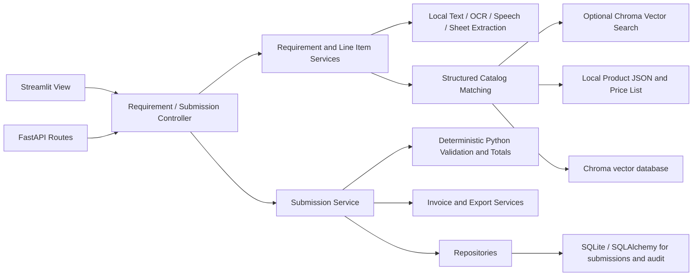
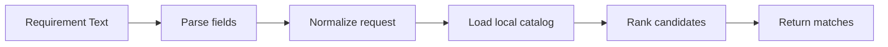
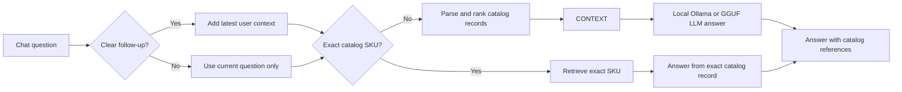

# Architecture and implementation

The application keeps the Streamlit view, controllers, business services, catalog model, and database access separate. FastAPI remains an optional backend surface. Local extraction and catalog retrieval run without cloud AI APIs.

## Request flow

The local LangGraph workflow in `app/graph.py` is a separate orchestration entry point:

The floating Streamlit catalog chat uses a second graph to answer read-only product enquiries and provide catalog details, including as a fallback when form autofill misses an item. Rows marked `Not Found` or `Needs Review` offer an enquiry button that opens chat with the row's product, size, and part number prefilled; the user submits the question and reads the catalog references. The chat retrieves relevant catalog records and generates a grounded response through local Ollama or llama.cpp when configured. It checks numeric SKU-like tokens against the canonical catalog first; an exact SKU match bypasses LLM extraction and semantic ranking, and the product name response comes directly from that exact record. Conversation context is carried into retrieval and answer generation only when the current message is a clear follow-up (for example, "What about its size?"). A standalone product request uses only its own text, preventing an old SKU or product from influencing a new lookup. The chatbot does not modify product form rows. If the model runtime is unavailable, the workflow returns a deterministic summary of the retrieved matches.

The main Streamlit workflow uses the same extraction, catalog, and validation services through controllers. LangGraph does not create a second price source and is not required to use the UI.

## MVC responsibilities

### Model and data

- `app/models/entities.py`: SQLAlchemy transactional submission and audit entities.
- `app/schemas/`: Pydantic contracts and validation at API/service boundaries.
- `app/database/session.py`: SQLite engine and session factory for transactional records.
- `app/repositories/`: database reads and writes; controllers and views do not issue SQL.
- `data/raw/`: original local catalog PDF.
- `data/processed/ashirvad_products.json`: normalized sellable SKU records used by matching and price resolution.

### View

- `app/streamlit_app.py`: customer input, text/image/PDF/voice/spreadsheet import, readable per-product cards, searchable match selection, floating catalog chat, box/loose quantity controls, confirmation, and downloads.
- The view displays service output and collects edits; validation and price calculations remain outside Streamlit.

### Controllers and services

- `app/controllers/requirement_controller.py`: coordinates extraction and line preparation.
- `app/controllers/submission_controller.py`: forwards final submission requests to the submission service.
- `app/services/requirement_service.py`: local extraction, normalization, and catalog enrichment. Extraction preserves source text and remains independent of catalog match success.
- `app/services/line_item_service.py`: per-row validation, catalog price basis enforcement, package-to-quantity conversion, and deterministic line/grand totals.
- `app/views/product_grid.py`: maps service records to editable product card fields and back without changing invoice rendering.
- `app/catalog/form_parser.py`: deterministic text normalization (including size-before-quantity phrasing), local OCR preprocessing, positioned bill-row parsing, and text-PDF table extraction.
- `app/services/line_item_service.py`: independently validates units and quantities, detects duplicates, and calculates line/grand totals with Decimal arithmetic.
- `app/services/submission_service.py`: revalidates confirmed data, creates the report, exports it, and persists submission/audit records through repositories.
- `app/invoice.py` and `app/invoice_export.py`: report formatting and PDF/CSV/JSON exports.

### Catalog retrieval

- `app/catalog/pdf_table_ingest.py`: reads catalog table cells, associates nearby section headings printed outside table grids, reconstructs rows that cross PDF column boundaries, and emits one record for each sellable SKU. Records preserve section title, source heading, HSN code, and combined search text.
- `app/catalog/matcher.py`: exact part-number filtering, strict ordered-size checks, HSN matching, and structured scoring over product names and catalog headings. The chat graph also detects exact catalog SKUs before parsing or semantic retrieval.
- `app/rag_price.py`: local catalog lookup adapter. It returns source price data and candidates; it does not generate prices.
- `app/services/semantic_retrieval.py`: optional local Chroma vector search over product attributes, headings, HSN codes, and combined search text. It reuses unchanged indexed documents across app restarts and embeds only new or changed records; vector similarity can change candidate ordering but cannot replace the structured source price.
- `app/services/catalog_chat_service.py`: handles greeting and product overview, carries context only for clear follow-ups, and routes independent catalog questions into the RAG chat graph without stale history.
- `app/services/local_llm.py`: extracts fields and, when a local GGUF model is configured, generates catalog-grounded chat answers.
- `app/catalog/csv_ingest.py`: legacy converted-CSV import path. New catalog builds should use `scripts/prepare_catalog.py`.

The PDF distinguishes per-meter reference rates from sellable 3 m and 5 m pipe SKUs. The importer stores each length SKU with its own part number and per-length price, while preserving its per-meter reference price. Fitting and accessory SKUs use the per-piece price basis. Missing dimensions or conflicting rows are marked for review.

## Match selection and price safety

1. If a part number is present, the matcher filters to that exact catalog SKU.
2. Otherwise, kind, exact size, name tokens, compound dimensions, SDR/class/schedule, and requested pipe length contribute to a deterministic score.
3. Optional local semantic similarity reranks those candidates only.
4. The service auto-selects only when the top match exceeds `MATCH_AUTO_THRESHOLD` and leads the next candidate by `MATCH_MARGIN_THRESHOLD`. Otherwise, the UI asks the user to resolve it.
5. The selected local record supplies the unit price and price basis. Python checks the quantity/unit and calculates `quantity × local unit price`; an incomplete line blocks the grand total/finalization.

No LLM or graph node writes to a database. SQLite writes happen after confirmation through the submission service and repositories. Audit events are stored with finalized submissions. Chroma stores product vectors for semantic retrieval; the processed product JSON remains the canonical catalog and price source.

## Catalog build and source version

`scripts/prepare_catalog.py` uses `CATALOG_PDF_PATH`, defaulting to `data/raw/Product_Price_List.pdf`, and writes the normalized records to `PRODUCT_DATA_PATH`, defaulting to `data/processed/ashirvad_products.json`. It also writes `catalog_quality_report.json` beside the catalog. The report includes record counts, price bases, and SKUs needing review.

The catalog supplied here states an effective date of 1 March 2025. The app does not download price lists. Replace the local source file with an authorized current price list and rebuild locally when it changes. Review the generated quality report before using the new prices.

## Local model configuration

`app/config.py` reads `.env` settings. `LLM_MODEL_PATH` can name a local Ollama model or a GGUF file; the default GGUF path is `models/llm/assistant.gguf`. The local LLM can extract fields and generate catalog-grounded chat answers but cannot set prices. Chroma vector search uses `models/embeddings/all-MiniLM-L6-v2` by default, or a local sentence-transformer model configured with `EMBEDDING_MODEL_PATH`. Whisper uses `models/whisper/whisper-small` by default, or `WHISPER_MODEL_PATH` if set. Chroma's persistent data is stored under `VECTOR_DB_PATH`. Without model files or a running local Ollama service, deterministic text parsing and exact/structured retrieval still work; voice transcription remains unavailable until its model is downloaded locally.

Main settings:

- `CATALOG_PDF_PATH`: source PDF for catalog builds.
- `PRODUCT_DATA_PATH`: processed local catalog JSON used during requests.
- `LLM_MODEL_PATH`: optional local GGUF file.
- `EMBEDDING_MODEL_PATH`: optional local sentence-transformer directory.
- `VECTOR_DB_PATH`: persistent Chroma vector database directory (default `data/vector_db`).
- `WHISPER_MODEL_PATH`: optional local speech model.
- `MATCH_AUTO_THRESHOLD`: minimum structured match score for auto-selection (default `0.82`).
- `MATCH_MARGIN_THRESHOLD`: minimum lead over the runner-up (default `0.08`).
- `DATABASE_URL`: SQLAlchemy URL for submission and audit records; defaults to local SQLite.

Paths can be absolute on Windows. Keep model and catalog paths on local storage for offline operation.

## Input/output references

See [the input guide](INPUT_GUIDE.md) for text examples, spreadsheet header aliases, unit expectations, and image/voice guidance. Final estimates are stored in the SQLite transaction database and exported as PDF, CSV, and JSON beneath `data/processed/`.
